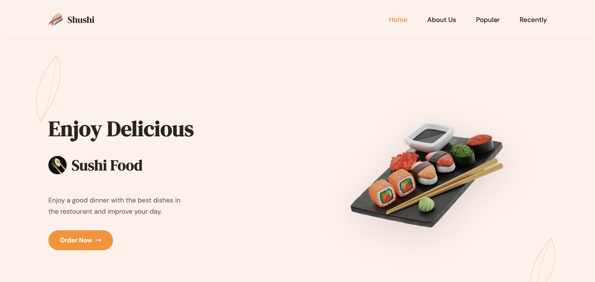

# Shushi – Sushi Restaurant Landing Page

A landing page for a fictional sushi restaurant, built with pure HTML and CSS.

**Live demo:** https://tutu-creator.github.io/Sushi-sayt/

## Features
- Fully responsive design for mobile, tablet and desktop
- Navigation with anchor links to page sections
- Hero section with call-to-action
- About section
- Popular dishes cards with prices and cart icons
- "Recently Added" product highlight
- Newsletter subscription section
- Footer with menu links, address, social icons and payment methods

## Built With
- HTML5
- CSS3
